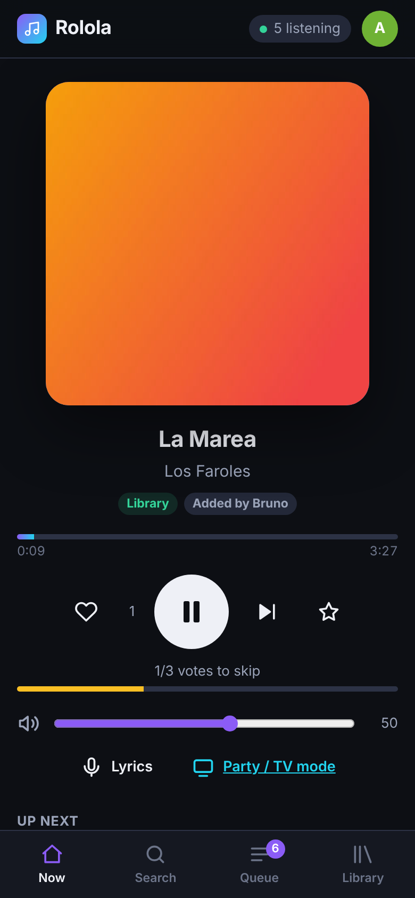
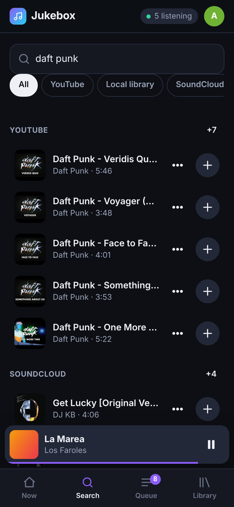
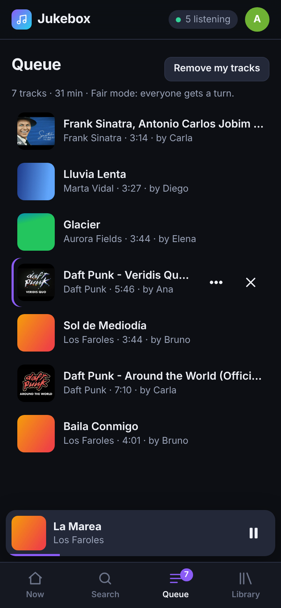
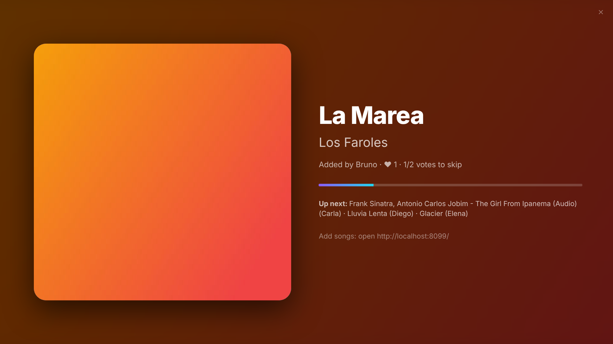

# Rolola

One shared music system for the office. Everyone opens a web page on their phone or PC, searches,
taps a song, and it plays through the speakers attached to one server (a TrueNAS SCALE box with an
analog output to an amplifier). The queue is fair, the room can vote to skip, and when the queue runs
dry it keeps going on its own.

**YouTube is the main source** (free, via yt-dlp). Your NAS music library, internet radio, SoundCloud,
Bandcamp, Jamendo, podcasts, direct links and Spotify links (played from the other sources) also work.

| Phone: now playing | Phone: search | Phone: queue | TV / party mode |
|---|---|---|---|
|  |  |  |  |

More screenshots: [`docs/screenshots/`](docs/screenshots) (desktop, admin panel, Spanish/light theme, SSO).

* [Quick start](#quick-start) · [TrueNAS SCALE](#truenas-scale) · [Configuration](#configuration)
* [Music sources](#music-sources) · [Reverse proxy](#reverse-proxy-tls-sub-path-sso) · [Backup](#backup--restore)
* [Audio troubleshooting](#audio-troubleshooting) · [API](#api) · [Development](#development)
* Docs: [Architecture](docs/ARCHITECTURE.md) · [Sources & risks](docs/SOURCES.md) · [Test plan](docs/TEST_PLAN.md) · [Roadmap](docs/ROADMAP.md) · [What we took from Spotube](docs/SPOTUBE.md)

---

## Quick start

```bash
git clone https://github.com/aa-eion/rolola && cd rolola
# 1. find your sound card NAME (not its number)
aplay -l            # e.g. "card 1: Generic_1 [HD-Audio Generic], device 0: ALC887"
getent group audio  # e.g. audio:x:29:   -> GID 29
# 2. edit docker-compose.yml: AUDIO_DEVICE, group_add, the music folder, TZ
docker compose up -d --build
docker compose logs -f   # first start prints where the generated admin password is
```

Open `http://<server>:8080`, pick a name, search, tap a result. That's it.

* The admin password is `ADMIN_PASSWORD`, or (if unset) a random one written to `/data/admin-password.txt`.
  Tap your avatar → *Admin login*. Change it in *Admin → Audio & diagnostics*.
* *Admin → Play test tone* checks the speakers (440 Hz for 3 seconds).
* Put a tablet or TV on `http://<server>:8080/#/display` for the full-screen party view.

## TrueNAS SCALE

TrueNAS SCALE (24.10 "Electric Eel" and later) runs Docker Compose apps natively:
**Apps → Discover Apps → ⋮ → Install via YAML**, paste [`deploy/truenas/compose.yaml`](deploy/truenas/compose.yaml),
adjust the marked lines and save. Step-by-step instructions, including the dataset permissions,
the `audio` group and finding the ALSA device, are in [`deploy/truenas/README.md`](deploy/truenas/README.md).

What the app needs:

| Setting | Value |
|---|---|
| Image | `ghcr.io/aa-eion/rolola:1.0.0` (or build from this repo) |
| Device | `/dev/snd:/dev/snd` |
| Supplementary group | the host `audio` GID (usually `29`) |
| User | `568:568` (TrueNAS `apps` user; the image default) |
| Volume (read-write) | a dataset, e.g. `/mnt/tank/apps/rolola` → `/data`, owned by 568 |
| Volume (read-only) | your music, e.g. `/mnt/tank/media/music` → `/music` |
| Port | `8080` (no host networking needed) |
| Env | `AUDIO_DEVICE=plughw:CARD=Generic_1,DEV=0`, `TZ`, optional `ADMIN_PASSWORD` |

## Configuration

Two layers:

1. **Environment variables**: deployment settings (paths, proxy trust, device). Table below.
2. **Admin panel**: everything about behaviour (fairness, limits, voting, volume caps, autoplay,
   schedule, sources and their credentials). Stored in `/data/rolola.db`.
   Any admin setting can be pre-seeded with `ROLOLA_DEFAULT_<SETTING>`, e.g. `ROLOLA_DEFAULT_LANGUAGE=es`.
   A value saved in the admin panel wins over the environment default.

### Environment variables

| Variable | Default | Meaning |
|---|---|---|
| `AUDIO_DEVICE` | `default` | ALSA device for mpv, **by name**: `plughw:CARD=Generic_1,DEV=0`. `null` = no sound (testing). Can be changed live in the admin panel. |
| `DATA_DIR` | `/data` | Database, settings, cache, credentials, yt-dlp updates. Mount a volume here. |
| `MUSIC_DIR` | `/music` | Local library root (mount read-only). |
| `PORT` / `HOST` | `8080` / `0.0.0.0` | HTTP listener. |
| `TZ` | `UTC` | Time zone for quiet hours and history. |
| `ADMIN_PASSWORD` | *(generated)* | Admin password. If unset, a random one is written to `/data/admin-password.txt` (mode 600). |
| `SECRET_KEY` | *(generated)* | Key that encrypts stored provider credentials. If unset, `/data/secret.key` is generated. |
| `BASE_PATH` | *(empty)* | Serve under a sub-path such as `/rolola` when the proxy does **not** strip the prefix. Root keeps working too. |
| `TRUSTED_PROXIES` | *(none)* | Comma-separated IPs/CIDRs of your reverse proxy. Only these may set `X-Forwarded-*` and identity headers. |
| `AUTH_HEADER` | *(empty)* | Trust this header as the user identity (e.g. `Remote-User`, `X-Forwarded-User`). Requires `TRUSTED_PROXIES`. |
| `AUTH_NAME_HEADER` | *(empty)* | Optional display-name header (e.g. `Remote-Name`). |
| `AUTH_GROUPS_HEADER` | *(empty)* | Optional groups header (e.g. `Remote-Groups`). |
| `ADMIN_USERS` | *(empty)* | Comma-separated proxy usernames that are admins. |
| `ADMIN_GROUPS` | *(empty)* | Comma-separated proxy groups whose members are admins. |
| `CACHE_MAX_MB` | `2048` | Size cap of the downloaded-audio cache (LRU). |
| `GUEST_EXPIRE_DAYS` | `30` | A device not used for this long is signed out; a name nobody uses for this long (with nothing queued) is deleted. |
| `HISTORY_DAYS` | `30` | Play history is kept this long (max 5 000 rows). |
| `YTDLP_AUTO_UPDATE` | `true` | Install the latest yt-dlp into `/data/ytdlp` daily (10 min after start, then every 24 h). |
| `LIBRARY_SCAN_INTERVAL_MIN` | `60` | Rescan the music folder every N minutes (incremental; `0` = only manual). |
| `LOG_LEVEL` / `LOG_JSON` | `INFO` / `true` | Structured JSON logs on stdout (also viewable in *Admin → Logs*). |
| `MPV_EXTRA_ARGS` | *(empty)* | Extra mpv flags, e.g. `--audio-samplerate=48000`. |
| `DISABLE_AUDIO` | `false` | Force mpv's null output (CI/demo). |

### Admin settings (also `ROLOLA_DEFAULT_*`)

| Setting | Default | |
|---|---|---|
| `fairness_enabled` | `true` | Round-robin across people (see below). |
| `max_queued_per_user` | `10` | `0` = unlimited. Admins are exempt. |
| `max_track_minutes` | `15` | Longer tracks are hidden from add / refused (admins exempt). |
| `skip_mode` / `skip_value` | `percent` / `50` | Votes needed: 50 % of connected listeners, or a fixed count. |
| `owner_can_skip` | `true` | Whoever added the track can skip it instantly. |
| `max_volume` | `85` | Hard cap on the output volume. |
| `volume_cooldown_s` | `10` | Per-person cooldown between volume changes. |
| `user_can_pause` / `user_can_seek` / `user_can_volume` | `true` / `false` / `true` | What non-admins may do. |
| `autoplay_mode` | `similar` | When the queue is empty: `similar` (YouTube mix from recent tracks), `history` (office favourites), `local_shuffle`, `playlist`, `radio`, `off`. |
| `autoplay_yield` | `true` | A user's track interrupts autoplay right away. |
| `schedule_enabled` / `schedule` | `false` | Quiet hours: music only inside the weekly windows (e.g. Mon–Fri 09:00–18:00). |
| `stale_minutes` | `60` | Paused for longer than this → the paused song and the old queue are dropped, so the next song someone adds plays right away (also after a restart). `0` = never. |
| `normalize` / `target_lufs` | `true` / `-18` | Loudness normalisation (EBU R128 measured per track). |
| `stream_gain_db` | `-4` | Fixed gain for radio streams (usually mastered louder). |
| `sponsorblock` | `true` | Skip non-music parts of YouTube music videos. |
| `lyrics` | `true` | Synced lyrics (LRCLIB) in the player and TV view. |
| `public_display` | `true` | Allow the read-only display page without a name. |
| `substitute_unavailable` | `true` | Play tracks from a disabled source via another source (marked in the UI). |
| `allow_private_urls` | `false` | Allow user links to LAN addresses (SSRF protection). |
| `language` | `en` | Default UI language (`en`, `es`); each person can switch. |

### People and storage (nothing to manage)

* **No passwords or PINs for listeners.** Type a name and you're in. The name *is* the identity:
  the same name on another PC, phone or incognito window continues as the same person (same queue,
  favourites and history). Two windows count as one listener.
* **Things expire by themselves.** A device not opened for `GUEST_EXPIRE_DAYS` (30) is signed out.
  A name nobody uses for that long, with nothing queued, is deleted with its favourites and
  personal playlists (shared playlists stay). *Cerrar sesión* on your last device deletes it immediately.
* **Bounded storage.** History keeps 30 days, lyrics/match/loudness caches 90 days, audio cache
  `CACHE_MAX_MB`. The database compacts itself daily. App logs live in memory only (*Admin → Logs*);
  container logs are capped by the compose file. The admin password is the only password.

### Stopping the music

* **Pause** (anyone, unless disabled): pauses the current song. A short pause resumes where it was.
* **Admin → Detener y vaciar todo** (*Stop & clear everything*): ends the song, empties the queue and
  keeps Rolola silent (autoplay included) until someone adds a song or presses play. Use it when
  everyone leaves the office.
* **Automatic fresh start:** if the music stays paused for more than `stale_minutes` (60), the paused
  song and yesterday's queue are discarded. The first song added the next morning plays immediately,
  with nothing to skip. With quiet hours enabled, the music also pauses and resumes by itself.

### How the fair queue works

Everyone has a personal sub-queue. The shared order takes the first track of each person, then the
second of each, and so on. Within a round, whoever was served longest ago goes first. If Ana adds
20 songs and Bruno adds one, Bruno's plays after Ana's first. People reorder their own tracks
(*Play next* moves to the top of *your* list). Admins can pin any track to play next.
Turn it off in the admin panel for a plain FIFO queue.

## Music sources

Honest status, account needs and terms-of-service risk for each source are in
[`docs/SOURCES.md`](docs/SOURCES.md) and in *Admin → Sources* (with a live status: connected, needs
setup, offline, rate-limited, broken).

| Source | Works out of the box | Setup |
|---|---|---|
| **YouTube** (main) | ✅ | Nothing. If you get "confirm you're not a bot": *Admin → Audio → Update yt-dlp now*. If that's not enough, paste a `cookies.txt` (below). |
| Local library | ✅ | Mount your music at `/music`. Tags and cover art (folder `cover.jpg` or embedded) are read automatically. |
| Internet radio | ✅ | Search ~50 000 stations (radio-browser.info). Add your own stream URLs in *Admin → Radio stations*. |
| SoundCloud | ✅ | Nothing. 30-second "Go+" previews are hidden. |
| Bandcamp | ✅ | Nothing. Only tracks artists stream for free. |
| Podcasts | ✅ | Search the Apple directory or paste an RSS feed URL. |
| Spotify links | ✅ | Paste a Spotify track/album/playlist link; each song plays from your library/YouTube (marked "via YouTube"). |
| Direct links | ✅ | Paste any audio/stream URL, or a web page yt-dlp understands. |
| Jamendo (Creative Commons) | needs key | Free client ID at <https://devportal.jamendo.com> → *Admin → Sources → Jamendo*. |
| Spotify (native), Tidal | ❌ planned | See [roadmap](docs/ROADMAP.md) and [sources](docs/SOURCES.md) for why. |

### YouTube cookies (only if YouTube blocks the server)

YouTube sometimes asks servers to prove they aren't bots. In order:

1. *Admin → Audio & diagnostics → Update yt-dlp now* (fixes most breakages).
2. Sign in to YouTube in a private browser window with a **throwaway** Google account, export
   cookies with an extension such as "Get cookies.txt LOCALLY", close the window without
   logging out, and paste the file into *Admin → Sources → YouTube → cookies.txt*. It is stored
   encrypted. Don't use your personal account: Google may flag accounts used this way.

## Reverse proxy (TLS, sub-path, SSO)

The app speaks plain HTTP and is built to sit behind a proxy:

* **Sub-path**: all UI and API URLs are relative. Either strip the prefix in the proxy (nginx
  example) or keep it and set `BASE_PATH=/rolola` (Traefik example). `/rolola` redirects to `/rolola/`.
* **WebSockets**: live updates use `GET /api/ws`, so forward `Upgrade`/`Connection` headers.
* **X-Forwarded-For/Proto/Host/Prefix** are honoured only from `TRUSTED_PROXIES`.
* **SSO**: set `AUTH_HEADER=Remote-User` (and optionally `AUTH_GROUPS_HEADER`, `ADMIN_GROUPS`).
  People are then identified automatically, with no name prompt. The header is ignored from anyone
  but the trusted proxy, and your proxy must overwrite or clear it on every request.

Ready-made configs: [`deploy/nginx.conf`](deploy/nginx.conf) (sub-path with prefix stripping, WebSocket,
Authelia hints) and [`deploy/traefik.yml`](deploy/traefik.yml) (own host or sub-path, forward-auth).
Both were tested: nginx in a container in front of the image, with WebSocket, sub-path cookies, an SSO
admin via group, and a spoofed header ignored.

## Backup & restore

Everything lives in the `/data` volume:

| Path | What | Back up? |
|---|---|---|
| `rolola.db` (+ `-wal`, `-shm`) | queue, history, users, playlists, favourites, settings | **yes** |
| `secret.key` | key for encrypted credentials (unless you use `SECRET_KEY`) | **yes, keep with the DB** |
| `admin-password.txt` | generated admin password (deleted when you change it) | optional |
| `cache/` | downloaded audio, rebuildable | no |
| `ytdlp/` | updated yt-dlp, rebuildable | no |

Consistent online backup (SQLite's own backup API, safe while running):

```bash
docker exec rolola python3 -c "import sqlite3; s=sqlite3.connect('/data/rolola.db'); d=sqlite3.connect('/data/backup.db'); s.backup(d); d.close()"
cp /mnt/tank/apps/rolola/{backup.db,secret.key} /somewhere/safe/
```

On TrueNAS, a periodic **ZFS snapshot** of the dataset is the simplest option (WAL mode makes snapshots crash-consistent).
**Restore**: stop the app, put `backup.db` back as `rolola.db` (delete stale `-wal`/`-shm`), restore `secret.key`, start.
Image updates never touch `/data`; the database schema migrates itself forward.

## Audio troubleshooting

Open *Admin → Audio & diagnostics*. It shows the configured device, the cards the container can see,
whether `/dev/snd` is writable, mpv's last errors, and a suggested device string per card.

| Symptom | Cause / fix |
|---|---|
| Banner "Sound card unavailable … Retrying" | mpv can't open the device. The queue is kept and retried every 10 s, so fix the device and it resumes. |
| `/dev/snd: missing` | Add `devices: - /dev/snd:/dev/snd`. |
| `/dev/snd: present, NOT writable` | The container user isn't in the host's `audio` group: `group_add: ["<GID of audio>"]` (`getent group audio` on the host, usually 29). |
| `Cannot get card index for X` | Wrong card name. Run `docker exec rolola aplay -l` and use `plughw:CARD=<id>,DEV=<n>`, where `<id>` is the word in brackets/after "card N:". |
| Works until reboot, then silent | You used `hw:1,0`; card numbers change. Always use `CARD=<name>`. |
| "Device or resource busy" | Something else holds the card (another container or host service). ALSA `hw`/`plughw` devices are exclusive. |
| Sound is distorted or the sample rate is rejected | Use `plughw:` (converts formats), not `hw:`. |
| Very quiet | Unmute or raise the hardware mixer once: `docker exec -it rolola alsamixer -c Generic_1` (or `amixer -c Generic_1 sset Master 90% unmute`). |
| Crackles under load | Give mpv priority: add `cap_add: [SYS_NICE]` (mpv then runs at nice −10). Everything else already runs at low priority. |

List devices from inside the container: `docker exec rolola aplay -L | grep -A1 plughw`
or `docker exec rolola mpv --audio-device=help`.

## API

Interactive docs at `/api/docs` (OpenAPI at `/api/openapi.json`). Create a token in *Admin → API tokens*, then:

```bash
T="Authorization: Bearer jbx_…"
curl -H "$T" "http://rolola:8080/api/state"                                  # now playing, queue, votes
curl -H "$T" "http://rolola:8080/api/search?source=youtube&q=daft+punk"
curl -H "$T" -H 'Content-Type: application/json' -X POST http://rolola:8080/api/queue \
     -d '{"track":{"source":"youtube","id":"K0HSD_i2DvA","title":"Around the World"}}'
curl -H "$T" -X POST http://rolola:8080/api/player/skip                         # vote (admin token: force)
```

Useful for chat bots ("/play …" in Slack), schedules ("pause at 12:30 for the all-hands") or a smart button.
Health: `GET /healthz` (liveness, includes engine/audio status) and `GET /readyz` (503 until mpv is up).

## Development

```bash
sudo apt install mpv ffmpeg            # the engine and loudness analysis
python3 -m venv .venv && . .venv/bin/activate && pip install -r requirements-dev.txt
DATA_DIR=./data MUSIC_DIR=~/Music AUDIO_DEVICE=null LOG_JSON=false python -m rolola
pytest                                 # unit + end-to-end tests (e2e needs mpv & ffmpeg)
```

No frontend build step: `rolola/web/` is plain HTML/CSS/ES modules. Add a UI language by copying
the `en` block in `rolola/web/i18n.js`. Add a music source by subclassing `Provider`
(see [architecture](docs/ARCHITECTURE.md#the-provider-plugin-interface)).

## License

Rolola is **free and source-available** under the [PolyForm Noncommercial License 1.0.0](LICENSE):
anyone may use, study, modify and share it at no cost for any **noncommercial** purpose
(personal use, hobby projects, research, schools, charities, public institutions...).
**Commercial use is not permitted.** Copies and modified versions must keep the license and its
`Required Notice` line.

**Why noncommercial:** several of Rolola's music sources (YouTube, SoundCloud, Bandcamp, Spotify
links) work in ways those services' terms of service don't allow. Offering or selling Rolola
commercially would turn those violations into a business. So the license only allows noncommercial
use, and the software comes **as is, without warranty or liability** (see the license text).

Because it forbids commercial use, Rolola is "source-available" rather than OSI-approved "open
source". The copyright holders themselves are not bound by these terms.

**Third-party components** keep their own licenses, listed in [THIRD_PARTY_NOTICES.md](THIRD_PARTY_NOTICES.md).
Most are permissive (MIT/BSD/Apache/Unlicense). mpv, FFmpeg and ALSA utilities are GPL programs run as
separate processes. One library, **mutagen** (tag reading for local music files), is
**GPL-2.0-or-later** and runs inside Rolola's process. The PolyForm license covers only Rolola's own
code: it does not relicense mutagen, which stays GPL. Strictly, the GPL does not allow its code to be
distributed together with extra restrictions such as "no commercial use", and some readers (including
the FSF) consider a Python program that imports a library to be one combined work. If you distribute
Rolola, distribute mutagen under the GPL with its source available (it is unmodified, from PyPI).

## Legal

This software is a tool. You are responsible for how you use it. Downloading from YouTube and
SoundCloud is against their terms of service, and playing music in a workplace may require a
public-performance licence where you live, whatever the source. See [`docs/SOURCES.md`](docs/SOURCES.md).
